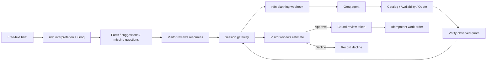

# Production Desk

A browser-based production planning demo built with **n8n, Groq, FastAPI, and PostgreSQL**. Includes local Docker Compose and a Vercel container deployment.

Built by [Khaled Abdulrahman](https://github.com/kira924).

**[Open the live demo](https://n8n-production-assistant-published.vercel.app)** · [Brief interpretation workflow](workflows/interpret-brief.json) · [Planning workflow](workflows/production-plan.json)

No account is required. After an idle period, the interface may briefly wait for the services to start.

Describe a production in your own words. A Groq model running through n8n extracts stated details and recommends studio hours, cameras, audio, and editing based on the brief and current synthetic catalog. The interface distinguishes explicit facts from estimates, explains each recommendation, and asks about missing dates or budgets. Review or edit the draft before requesting a verified SAR estimate, then explicitly approve or decline it. Approval creates one synthetic work order; declining, an unavailable resource, or an insufficient budget does not.

**All resources, prices, and work orders are synthetic.** This demo does not book inventory, charge payments, or connect to a company's ERP.

## How it works



- **n8n** runs both interpretation and planning. Interpretation recommends resources from natural language; estimates remain visibly labeled and editable. The planning agent's three tool parameters are bound to the visitor's reviewed inputs. The agent's prose is not a source of prices or quote IDs.
- **FastAPI** verifies the canonical quote, availability, budget, and session ownership. It performs explicit human decisions and creates a work order using a short-lived token and an idempotency key.
- **The browser** displays the request, line items, plan, and result. Visitors can review only requests in their own anonymous session. Workflow credentials and approval tokens remain on the server.
- **nginx** exposes the visitor interface and its API routes. Internal planning tools, the callback endpoint, and the n8n editor are excluded from the visitor proxy.
- **Cloud runtime:** one HTTP-only container runs the same n8n workflow and gateway. Neon PostgreSQL persists sessions, quotes, decisions, orders, and encrypted n8n configuration across cold starts. The public proxy keeps planning requests in flight and hides the internal services.

## Try locally

Follow [Docker setup](docs/DEPLOYMENT.md) to create `.env`, add a Groq key, start the containers, create the n8n owner account, and bootstrap the planning workflow.

| Address | Purpose |
|---|---|
| `http://localhost:8088` | Visitor interface |
| `http://localhost:5688` | Local n8n administration |

The interface includes interview, silent product-ad, and incomplete-brief examples. The model's recommendations can differ by brief; the final price depends on the reviewed resources. A two-hour, two-camera setup with audio and two editing hours costs **2240 SAR** from the synthetic catalog. Resources and unit rates are visible before submission and come from the same catalog used by the model.

## Repository

| Path | Purpose |
|---|---|
| `erp_demo/` | Canonical pricing, synthetic availability, expiring review tokens, idempotent orders |
| `api/` | Session ownership, CSRF, submission limits, n8n callbacks, human decisions |
| `web/` | Arabic responsive request and review interface |
| `workflows/production-plan.json` | Importable n8n planning workflow without API keys |
| `workflows/interpret-brief.json` | Free-text interpretation and resource recommendations |
| `deploy/` | Dockerfiles, nginx routing, credential/workflow bootstrap |
| `compose.yaml` | Independent three-service stack and named volumes |
| `Dockerfile.vercel` | Full cloud runtime built remotely, without local Docker |
| `storage.py` | SQLite/PostgreSQL storage and transaction serialization |
| `tests/` | Gateway isolation, validation, rejection, approval, and retry tests |
| `docs/` | Setup and verification notes |

## Checks

```sh
python -m pip install -r requirements.txt
python -m pytest erp_demo/test_app.py tests -q
node workflows/check-policy.cjs
node --check web/assets/app.js
```

The tests cover pricing and quote integrity, rejection paths, session isolation, explicit approval, token binding, and repeated requests. See [validation](docs/VALIDATION.md) for the verification scope and container/runtime status.

## Scope

The public visitor approves their own synthetic request. This is not a staff identity or organizational authorization system. Deployment to a real production workflow would require authenticated reviewer roles, real inventory/reservation logic, and operational monitoring. The documented cases establish specific behaviors rather than a general model success rate.
